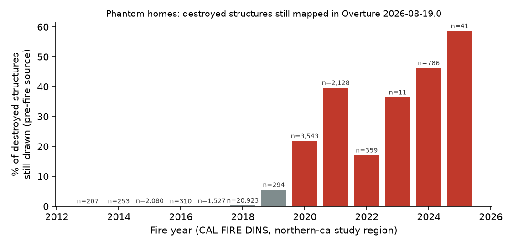
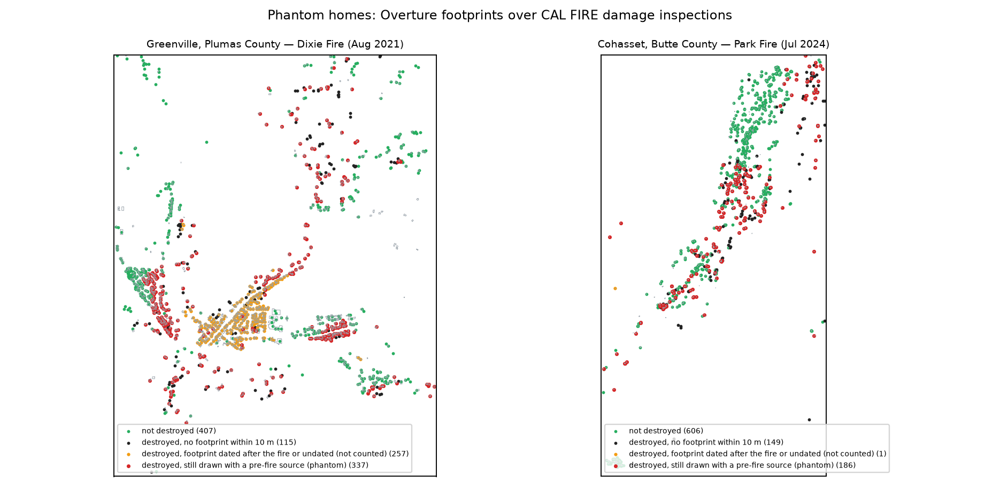

# Phantom homes: one in three homes destroyed by recent wildfires is still on the map

**Best Bias Discovery entry · Zindi user Arnaud_TOE · Bias Bounty Mapping Equity Challenge**
*Version 1.0, 2026-10-23. Associated leaderboard submission: `iu1dZ8Hf` (public RMSE 0.078204).
Code and outputs: https://github.com/Arnaud-TOE/bias-bounty-phantom-homes. Two commands regenerate every number (Section 7).*

## The finding in one paragraph

In the Northern California study region, CAL FIRE inspected every structure inside the
perimeters of recent wildfires. Of the **6,868 structures destroyed by fires from 2020 to
2025**, **2,063 (30.0 %) are still drawn as standing buildings** in Overture release
2026-08-19.0. Each of these footprints has a source date (Microsoft imagery date or
OpenStreetMap last edit) **earlier than the day the fire started**, so none of them can be a
rebuilt home. Among them are **1,421 dwelling units**. Net of chance proximity (a placebo
60 m away), the excess is **24.3 % (95 % CI 17.4–35.8 %, clustered by fire), about 1,670
structures**. For fires up to 2019 the same rate is **0.2 %**: the map eventually catches up,
but for five years after a disaster it keeps showing neighbourhoods that no longer exist. Greenville (Dixie Fire, 2021), Berry Creek
(North Complex, 2020), Cohasset (Park Fire, 2024) and the Karuk communities of Happy Camp
and the Klamath River carry hundreds of these *phantom homes*.

## 1. Why the automated scorecard cannot see it

- **The coverage gap is one-sided.** Every component is `1 − min(1, Overture / reference)`.
  A map that shows *more* than exists is scored as perfect coverage, so phantom structures
  can only hide gaps, never reveal them.
- **Burn scars look well mapped.** A tract whose homes burned but stay drawn keeps its full
  building count. The scorecard's wildfire stratum therefore reports these tracts as
  covered. If the building reference also predates the fire, the building component simply
  compares two pre-fire maps.
- **No stratum measures time since disaster.** The five metrics stratify by urban/rural,
  SVI, CVI, tribal status and hazard exposure. None of them asks whether the map was updated
  after the hazard actually struck.

## 2. Evidence

**Data.**
- CAL FIRE Damage Inspection (DINS) points: one record per inspected structure, with damage
  class, incident name and start date (49,168 points inside the northern-ca scored tracts).
- Overture buildings from the challenge extract.
- Tract strata from the challenge package.
- Sources and checksums are listed in Section 7.

**Definition (deliberately conservative).** A destroyed structure is a *phantom* when:
1. an Overture footprint lies within 10 m (exact distance in California Albers, EPSG:3310);
2. that footprint's source date is known (the Microsoft placeholder date 2000-01-01 is
   excluded);
3. that date is earlier than the fire's start date.

Footprints dated after the fire might be rebuilt homes and are never counted. In downtown
Greenville this excludes 257 destroyed structures that still sit under a footprint
(Figure 2, orange), so the true number of phantoms is higher than reported.

**Main result**

| | Fires ≤ 2019 | Fires 2020–2025 |
|---|---|---|
| Destroyed structures (DINS) | 25,594 | **6,868** |
| Phantoms within 10 m | 59 (0.2 %) | **2,063 (30.0 %)** |
| …of which dwelling units | 40 | **1,421** |
| Point inside the footprint (0 m) / 5 m / 20 m | 0.2 % / 0.2 % / 0.3 % | 22.1 % / 27.4 % / 34.0 % |
| Placebo: same points shifted 60 m (seeded) | 0.04 % | 5.8 % |
| **Excess over placebo** (95 % CI, bootstrap over 85 fires) | — | **24.3 % (17.4–35.8 %), ≈ 1,670** |
| Control: standing structures matched within 10 m | 85.3 % | 69.2 % |
| Source of the phantom footprint: Microsoft ML / OpenStreetMap | — | 1,602 / 461 |



*Figure 1. Share of destroyed structures still drawn with a pre-fire source, by fire year
(red: 2020 and later).*

**By fire** (destroyed / phantoms / share):
- Dixie 2021: 1,311 / 471 / 36 %
- North Complex 2020: 2,352 / 398 / 17 %
- Park 2024: 713 / 323 / 45 %
- LNU Lightning Complex 2020: 364 / 264 / 73 %
- Fawn 2021: 185 / 127 / 69 %
- Slater 2020: 353 / 55 / 16 %
- Cache 2021: 60 / 53 / 88 %
- Camp 2018 (Paradise): 18,804 / 29 / **0.2 %**. The largest disaster *was* cleaned from the
  map; the smaller, more remote ones were not.

**Named communities** (phantoms, dwelling units):
- Greenville, Plumas Co. (350, 233)
- Berry Creek, Butte Co. (165, 110)
- Cohasset, Butte Co. (153, 109)
- Napa (128, 111)
- Redding (126, 66)
- Happy Camp, Siskiyou Co. (55, 40)
- Chester (39, 28)
- Doyle (37, 26)

**Named tracts** (`discovery/out/phantom_by_tract.csv`):

| GEOID | Area | Phantoms | SVI | Note |
|---|---|---|---|---|
| 06007002402 | Berry Creek | 382 | 0.81 | Enterprise Rancheria |
| 06063000400 | Greenville | 357 | — | Greenville Rancheria |
| 06055201800 | Napa County | 262 | 0.77 | — |
| 06007001602 | Cohasset | 226 | — | — |
| 06093001300 | Klamath River / Happy Camp | 79 | 0.83 | Karuk Off-Reservation Trust Land |
| 06033000702 | Clearlake | 53 | 0.97 | 88 % of destroyed homes still drawn |
| 06035040600 | Lassen County | 41 | 0.87 | Susanville Off-Reservation Trust Land |



*Figure 2. Greenville (Dixie 2021) and Cohasset (Park 2024). Red: destroyed, still drawn
with a pre-fire source. Orange: destroyed, footprint dated after the fire (not counted).
Black: destroyed, no footprint. Green: not destroyed.*

**Who is exposed.** Recent fires hit the most vulnerable tracts. Of the destroyed structures,
52.5 % stand in tracts in the top SVI quartile band (SVI ≥ 0.75), against 31.3 % of the
region's tracts; phantoms follow them (47.6 %, 1.5 times the regional share). Within the same
fire (linear probability model with fire fixed effects and tract-clustered errors), the
phantom rate does not rise further with SVI (p = 0.71). It is 11.5 points higher in tracts that
touch a tribal statistical or legal area (p < 0.001), although this rests on 17 tracts
(`out/phantom_exposure.csv`).

## 3. Who is affected and what it changes

The people affected are those already displaced: households in Greenville, Berry Creek,
Cohasset, Happy Camp and Doyle, many of them in high-SVI tracts and in Rancheria and Karuk
trust-land areas. They are still rebuilding, and the next fire season arrives on a map that
describes the town as it was before the last one.

- **Evacuation.** Evacuation zones are sized and staffed from structure and population
  counts. In Greenville the map still carries 350 structures (233 dwelling units) that burned
  in 2021, so door-to-door notification lists and estimates of people at risk built from it
  are inflated in exactly the zones that will be ordered out again.
- **Structure triage and dispatch.** Pre-incident plans and structure-protection triage can be
  built on footprint inventories. An engine assigned to a "structure" that is an empty lot is
  an engine not protecting a home that was rebuilt next door.
- **Relief and recovery.** Damage-assessment baselines and recovery dashboards that start from
  the map will count these 1,421 dwelling units twice: as destroyed in 2021, and as standing
  in the next disaster's baseline. The recovery gap, meaning the people still displaced,
  becomes invisible.

**Why the map stays frozen.** Two mechanisms meet in Overture:
- OpenStreetMap practice discourages deleting burned buildings. Mappers are told to re-tag
  them with a lifecycle prefix (`destroyed:building`), often only once imagery is updated;
  until someone does, the polygon stays a building. This is the case for 461 of our 2,063
  phantoms: OpenStreetMap source, last edited before the fire.
- Microsoft ML footprints come from imagery captured before the fire: 1,602 phantoms, with
  known imagery dates earlier than the fire's start.

The same frozen footprints feed exposure products. In the Greenville tract (06063000400) the
357 phantoms are **16.5 % of all Overture buildings**. The challenge's own exposure layer,
USFS Wildfire Risk to Communities (2nd edition, "2022 conditions", strata column
`usfs_BuildingCount_sum`), counts 2,440 buildings there, more than Overture's 2,170 including
the phantoms. This is consistent with an exposure layer also built on pre-fire footprints. It
is a tract-level comparison, not a proof, and the column is used here only for this check,
never in our scored pipeline. The remediation follows directly: re-tag footprints from CAL
FIRE damage inspections after each fire, and date ML footprints by imagery so that consumers
can mask pre-fire geometry inside new fire perimeters.

## 4. Robustness

- The result does not depend on the search radius (22–34 % between 0 and 20 m).
- It is not chance proximity: the placebo stays at 5.8 %, and the excess over it is 24.3 %
  with a 95 % interval of 17.4–35.8 % when whole fires are resampled.
- It is not a matching artefact: standing structures are matched at 69–85 %.
- Rebuilt homes are excluded by construction (source date before the fire).
- The ≤ 2019 contrast shows the method finds almost no phantoms where the map has had time to
  update.

## 5. Limits

- One region and one ground-truth source (CAL FIRE covers California only).
- DINS points are inspector-placed and can sit a few metres from the structure; the radius
  sensitivity bounds this.
- Microsoft source dates are imagery dates assigned per tile.
- Footprints dated after a fire may still be stale, so the count is a lower bound.
- The Eastern Washington fires of 2020 and 2023 are not covered (no equivalent public
  structure-level inspection data).

## 6. How this entry relates to other entries

Another entry (#35474) also matches CAL FIRE inspections to Overture footprints. It reports
about 1,200 likely stale footprints in zones where the AI imagery predates the fire, and a
destroyed-versus-undamaged match ratio of 0.89 (95 % CI 0.72–1.06). We read that as
independent confirmation and add five things it does not establish:
1. **The time dimension.** The same test on 25,594 structures destroyed up to 2019 finds
   0.2 %. The problem is specific to recent disasters, and the largest one (Camp 2018) was
   cleaned while smaller, more remote fires were not.
2. **A control-adjusted estimate.** The placebo gives the chance rate directly (5.8 %), hence
   an excess with a fire-clustered interval that excludes zero (17.4–35.8 %), where a match
   ratio whose interval includes 1 cannot separate staleness from matching rate.
3. **A per-footprint date rule** (each footprint's own source date against the fire's start),
   rather than a zone's modal imagery date. It also catches the **461 OpenStreetMap
   phantoms** (22 %), a separate cause (the lifecycle-tag practice) that imagery dating cannot
   reveal.
4. **Who is exposed**: 1,421 dwelling units, the SVI and tribal-area contrasts, the named
   communities, and the 24 tracts with at least 10 phantoms (`out/phantom_by_tract.csv`).
5. **The link to exposure products** and a concrete remediation.

## 7. Reproducibility

```bash
python -I get_data.py              # challenge extract (~470 MB) and external files, SHA-256 checked
python -I discovery/reproduce.py   # rebuilds every number, table and figure (~2 min)
```

| Source | URL | Retrieved | SHA-256 |
|---|---|---|---|
| CAL FIRE DINS (CC-BY) | https://gis.data.cnra.ca.gov/api/download/v1/items/994d3dc4569640caadbbc3198d5a3da1/csv?layers=0 | 2026-10-17 | `af01e965…38404f` |
| CMS Nursing Home Provider Information (public, annex) | https://data.cms.gov/provider-data/dataset/4pq5-n9py | 2026-10-17 | `378d76a4…d1e2b0` |
| Overture 2026-08-19.0 buildings, challenge extract | `reference/northern-ca/northern-ca-overture-buildings.parquet` | 2026-10-16 | SHA-256 in `get_data.py` |

External data is used for this discovery only. The scored leaderboard pipeline never reads it:
its I/O guard refuses any non-permitted path, and that code is published separately once the
leaderboard closes (31 October 2026).

## Annex — Medicare nursing homes in wildfire country (secondary)

1,516 CMS-certified nursing homes lie in the scored tracts. 75 % have an Overture place of the
same name within 250 m. The rate falls from 79.4 % in the least wildfire-exposed quarter of these homes (tract USFS WHP)
to **68.3 %** in the most exposed one, where evacuating non-ambulatory
residents is most time-critical. It does not fall with SVI (71 % in the least vulnerable quarter,
79 % in the most). Name matching undercounts renamed
or chain facilities, so these are upper bounds on missing facilities (`discovery/cms_nursing_homes.py`,
`out/cms_by_whp_quartile.csv`, `out/cms_by_svi_quartile.csv`).
